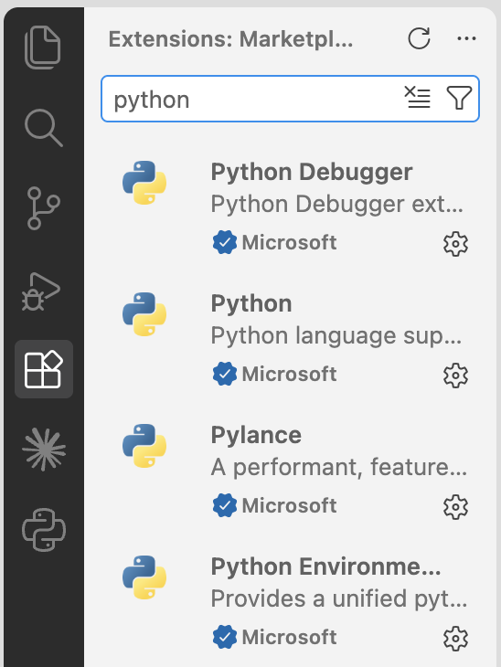
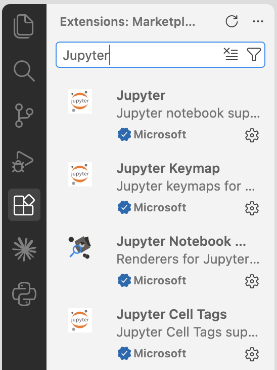
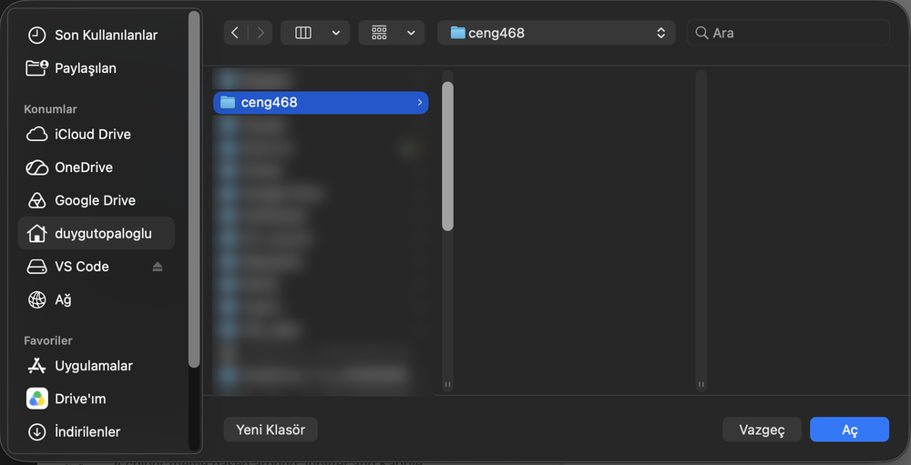
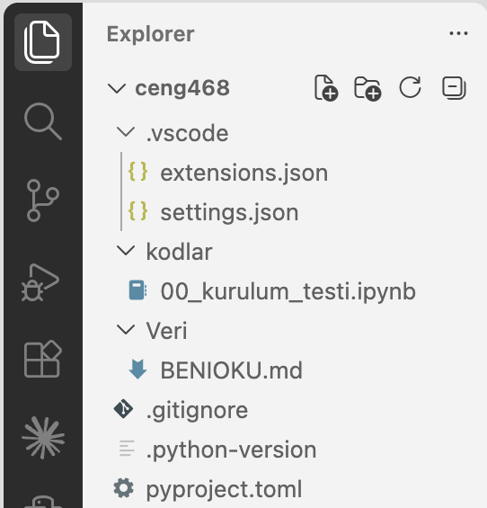
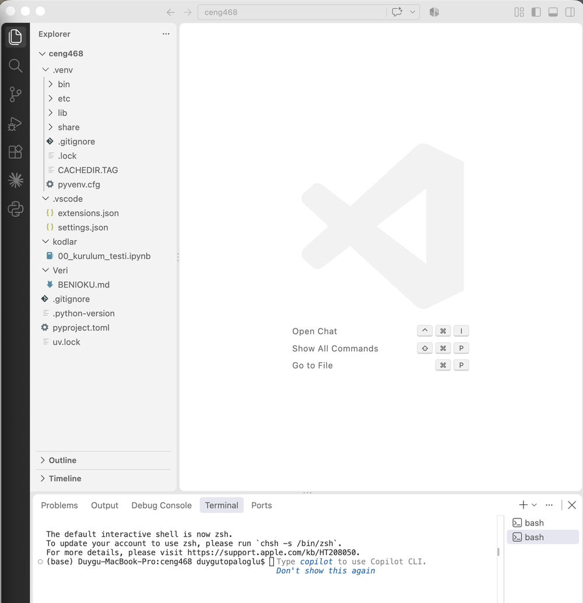
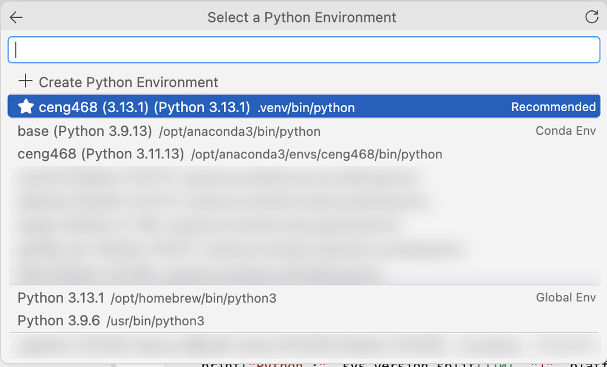
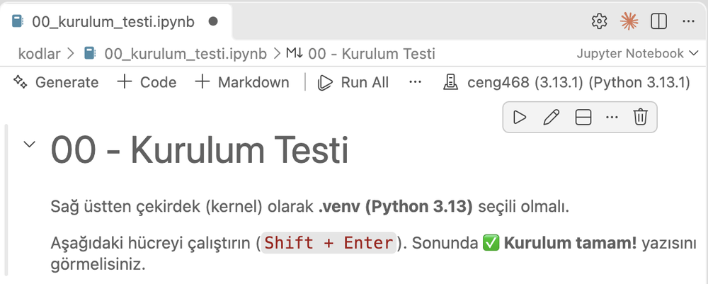
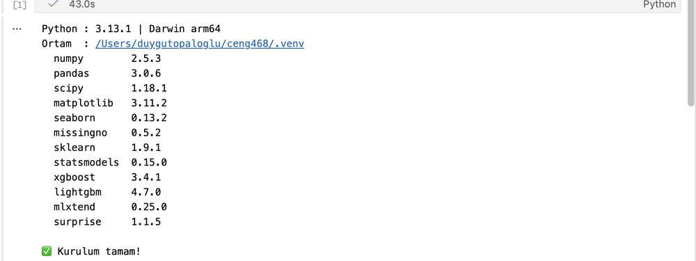
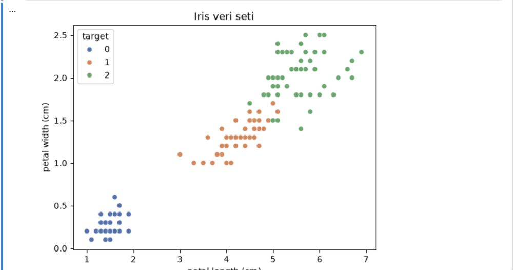

# CENG468 · Python Ortamı Rehberi

Bu rehber iki iş görür: **neden** böyle bir ortam kurduğumuzu anlatır ve kurulumu **ekran görüntüleriyle** adım adım gösterir. Kısa kurulum listesi ve sorun giderme tablosu ana sayfadaki [README](../README.md)'de.

**İçindekiler**
1. [Kavramlar](#1-kavramlar)
2. [Alıştırma A: Ders ortamını kurmak](#2-alıştırma-a-ders-ortamını-kurmak)
3. [Derste çalışırken](#3-derste-çalışırken)
4. [Alıştırma B: Kendi projeni sıfırdan kurmak](#4-alıştırma-b-kendi-projeni-sıfırdan-kurmak)
5. [Altın kurallar](#5-altın-kurallar)

> Ekran görüntüleri Mac'te alındı. Windows'ta pencereler biraz farklı görünür ama düğme adları ve komutlar aynıdır. Farklı olan yerlerde Windows ayrıca yazılmıştır.

---

## 1. Kavramlar

### 1.1 Neden "ortam"?

Python kodu bir **yorumlayıcıda** çalışır; `pandas` gibi kütüphaneler bu yorumlayıcıya **kurulur**. Sorun şu: farklı projeler aynı kütüphanenin farklı sürümlerini isteyebilir.

| | Proje 1 | Proje 2 | Proje 3 |
|---|---|---|---|
| Python | 3.11 | 3.13 | 3.12 |
| pandas | 2.3 | 3.0 | 2.2 |

Hepsi bilgisayardaki tek bir Python'a kurulsaydı, birini güncellemek diğerini bozardı. Çözüm: her projeye **kendi Python'u ve kendi kütüphaneleri olan ayrı bir kutu** vermek. Bu kutuya **sanal ortam** (virtual environment) denir.

Bu dersin ortamı ders klasörünün içindeki **`.venv`** klasörüdür. Sınıftaki herkesin `.venv`'inde birebir aynı sürümler bulunur; "bende çalışıyordu" sorunu yaşanmaz.

### 1.2 Araç ve biçim: uv, conda, venv

Bu üç kelime sık karışır, çünkü biri **araç**, biri **biçim**, biri ikisi birden:

| | Ne? | Bu derste |
|---|---|---|
| **venv** | Python'un **standart ortam biçimi**: içinde Python ve paketler olan bir klasör (`.venv`) | ✅ Ortamımız bu biçimde |
| **uv** | Ortamı **kuran araç**: Python'u indirir, `.venv`'i oluşturur, paketleri kurar | ✅ Kullandığımız araç |
| **conda / Anaconda** | Hem araç hem kendine özgü ortam biçimi | ❌ Bu derste kullanmıyoruz |
| **pip** | Paket kurma aracı | ❌ Doğrudan kullanmıyoruz (uv bizim yerimize yapar) |

> 💡 "conda yerine uv dedik, neden bir de venv var?" sorusunun cevabı: uv **araçtır**, venv **biçimdir**. uv, ortamı venv biçiminde kurar. VS Code bu biçimi ek ayar gerekmeden tanır.

### 1.3 "15 paket istedik, neden 61 kuruldu?"

Ders için istediğimiz 15 paket var (`pandas`, `scikit-learn`, `seaborn` …). Ama her paketin de **kendi ihtiyaç duyduğu paketler** vardır. Örnek olarak iki tanesine bakalım:

```
ceng468
├── pandas
│   ├── numpy
│   └── python-dateutil
│       └── six
└── scikit-learn
    ├── joblib
    │   └── cloudpickle
    ├── narwhals
    ├── numpy
    ├── scipy
    │   └── numpy
    └── threadpoolctl
```

Sadece bu iki paket için 8 paket daha geliyor (`numpy` iki yerde görünüyor ama bir kez kurulur). 15 paketin hepsi için bu ağaç toplam **61 pakete** ulaşır. Bu normaldir. VS Code'un paket listesinde bunların bir kısmının yanında *transitive* (dolaylı) yazar: "sen istemedin, istediğin paket istedi" demektir.

`uv sync` çıktısındaki iki sayının farkı da buradan gelir:

```
Resolved 67 packages   ← Windows, Mac ve Linux'un HEPSİ için hesaplanan liste
Installed 61 packages  ← yalnızca SENİN işletim sistemine gerekenler
```

Kendi bilgisayarında ağacın tamamını görmek için terminalde: `uv tree`

### 1.4 Ortamı tarif eden iki dosya

| Dosya | Ne yazar? | Kim yazar? | Eski karşılığı |
|---|---|---|---|
| `pyproject.toml` | "Şu paketler lazım" (15 satır) | Hoca | `requirements.txt` |
| `uv.lock` | "Tam olarak şu sürümler", her işletim sistemi için | uv (elle düzenlenmez) | `pip freeze` çıktısı |
| `.python-version` | Hangi Python sürümü (3.13) | Hoca | — |

`uv sync` bu dosyalara bakar ve `.venv`'i onlara **eşitler**. Bu yüzden `.venv`'i silip `uv sync` dediğinde birebir aynı ortam geri gelir.

### 1.5 VS Code'da üç ayrı yer

VS Code'da "ortam" ile ilgili üç farklı yer var ve karıştırılırlar:

| Yer | Nasıl açılır | Ne işe yarar |
|---|---|---|
| **Explorer** | Sol çubukta en üstteki dosya simgesi (`Ctrl+Shift+E`, Mac `Cmd+Shift+E`) | Klasördeki **dosyaları** gösterir |
| **Python paneli** | Sol çubukta Python logosu | **Ortamları** ve kurulu paketleri gösterir. Bilgi almak için bakın; düğmeleriyle ortam **oluşturmayın** |
| **Terminal** | **Terminal → New Terminal** (`` Ctrl+` ``) | `uv` komutlarını yazdığınız yer. Hiçbir şey sormaz; bulunduğu klasörün `.venv`'ini kullanır |

[EKRAN GÖRÜNTÜSÜ: Python paneli: ortam ve paket listesi]

Hangi ortamın kullanılacağına kim karar verir?

| Ne çalıştırıyorsun | Hangi ortamı kullanır | Ne belirler |
|---|---|---|
| `uv sync`, `uv add`, `uv run` | Bulunduğun klasörün `.venv`'i | Klasör |
| Notebook hücreleri | Sağ üstte seçili **kernel** | Kernel seçimi |
| `.py` dosyası | Sağ altta seçili **interpreter** | Interpreter seçimi |
| Terminalde düz `python` / `pip` | Terminalde etkin olan ortam | ⚠️ Yanlış ortama gidebilir; kullanmayın |

> ⚠️ VS Code'un **"Python: Create Environment"** komutunu ve Python panelindeki **"+"** düğmesini bu derste kullanmıyoruz. Bunlar pip ile ya da farklı bir şablonla kurar; ortamı yalnızca terminaldeki `uv` komutları kurar.

---

## 2. Alıştırma A: Ders ortamını kurmak

Toplam ~15 dakika, **bir kez** yapılır.

### A1. VS Code eklentileri

VS Code'u kurun (<https://code.visualstudio.com>). Sol çubukta **Extensions**'ı açın (`Ctrl+Shift+X`, Mac `Cmd+Shift+X`). Arama kutusuna `Python`, sonra `Jupyter` yazın; yayıncısı **Microsoft** olanları kurun.

| Python | Jupyter |
|---|---|
|  |  |

Yanında **Install** yerine ⚙️ (dişli) görüyorsanız eklenti kuruludur. Python eklentisi; Pylance, Python Debugger ve Python Environments'ı da beraberinde getirir.

### A2. uv'yi kurun

**Windows** (Başlat → PowerShell):
```powershell
powershell -ExecutionPolicy ByPass -c "irm https://astral.sh/uv/install.ps1 | iex"
```
**Mac** (Terminal):
```bash
curl -LsSf https://astral.sh/uv/install.sh | sh
```

Bitince **terminali kapatıp yeniden açın** ve kontrol edin:
```
uv --version
```
`uv 0.x.x` gibi bir sürüm görmelisiniz.

> ⚠️ Windows'ta *"running scripts is disabled on this system"* hatası alırsanız PowerShell'de bir kez çalıştırın: `Set-ExecutionPolicy -Scope CurrentUser RemoteSigned`

[EKRAN GÖRÜNTÜSÜ: Windows PowerShell'de uv kurulumu ve uv --version]

### A3. Git'i kontrol edin

```
git --version
```
Sürüm yazıyorsa geçin. Yazmıyorsa: **Windows**'ta <https://git-scm.com/download/win> adresinden indirip varsayılan ayarlarla kurun; **Mac**'te komut "Command Line Developer Tools" kurulumunu önerir, **Yükle** deyin. Kurulumdan sonra terminali kapatıp açın.

### A4. Ders klasörünü indirin

```
cd ~
git clone https://github.com/duygutopaloglu/CENG468.git ceng468
```

`cd ~` sizi **kullanıcı klasörünüze** götürür; ders klasörü orada oluşur:

| Sistem | Klasörün yeri |
|---|---|
| Windows | `C:\Users\<adınız>\ceng468` |
| Mac | `/Users/<adınız>/ceng468` |

> ⚠️ **Neden Masaüstü ya da Belgeler değil?** Bu klasörler Windows'ta çoğunlukla **OneDrive**, Mac'te **iCloud** ile senkronize edilir. Google Drive da öyle. Senkronizasyon `.venv`'deki on binlerce dosyayı bozar. Kullanıcı klasörü senkronize edilmez.
>
> Kolay erişim için: Mac'te `ceng468`'i Finder'ın kenar çubuğuna sürükleyin; Windows'ta sağ tık → **Hızlı erişime sabitle**.

### A5. Klasörü VS Code'da açın

**File → Open Folder** (`Ctrl+K Ctrl+O`, Mac `Cmd+O`). Kullanıcı klasörünüzde `ceng468`'i seçip **Open / Aç**'a basın.



VS Code *"Do you trust the authors of the files in this folder?"* diye sorarsa **Yes, I trust the authors** deyin.

[EKRAN GÖRÜNTÜSÜ: "Do you trust the authors" sorusu]

Explorer'da `ceng468` başlığı ve dosyalar görünmeli:



Sağ altta *"This workspace has extension recommendations"* bildirimi çıkarsa **Install** deyin; ders klasörü gerekli eklentileri kendisi öneriyor.

### A6. Ortamı kurun: `uv sync`

**Terminal → New Terminal** (`` Ctrl+` ``) ile terminali açın. Terminal `ceng468` klasöründe açılır. Çalıştırın:

```
uv sync
```

Şuna benzer bir çıktı görmelisiniz (süreler ve Python yolu sizde farklı olur):

```
Using CPython 3.13.x interpreter at: ...
Creating virtual environment at: .venv
Resolved 67 packages in 1.79s
Prepared 61 packages in 15.57s
Installed 61 packages in 265ms
 + appnope==1.0.0
 + asttokens==3.0.2
 ...
 + pandas==3.0.6
 ...
 + xgboost==3.4.1
```

**Kontrol:** `Creating virtual environment at: .venv` ve `Installed … packages` satırlarını gördüyseniz tamamdır. `+` işareti "bu paket kuruldu" demek. Bilgisayarınızda Python yoksa önce `Downloading cpython-3.13…` satırı da görünür; uv Python'u kendisi indirir.

Explorer'da artık **`.venv`** klasörü ve **`uv.lock`** dosyası var:



> 💡 Terminalde satır başında `(base)` görüyorsanız bilgisayarınızda Anaconda var ve açık. `uv` komutları yine doğru çalışır; yalnızca `pip install` yazmayın (paketi Anaconda'ya kurar, ders ortamına değil).

### A7. Veriyi indirin

`Veri/online_retail/BENIOKU.md` dosyasını açın ve adımları izleyin. Veri dosyası repoda **yoktur**; sonuçta dosya şurada olmalı:

```
ceng468/Veri/online_retail/online_retail_II.xlsx
```

### A8. Kurulumu test edin

1. Explorer'da `Kodlar/00_kurulum_testi.ipynb` dosyasını açın.
2. Sağ üstte **Select Kernel**'e basın. Listeden **⭐ Recommended** etiketli, yolu **`.venv`** ile başlayan ortamı seçin:



> ⚠️ **Ada değil, yola bakın.** Yukarıdaki listede iki tane `ceng468` var: üstteki (⭐, `.venv/bin/python`) bizim ortamımız; alttaki (`/opt/anaconda3/envs/ceng468`) eski bir Anaconda ortamı. Doğru yol Mac'te `.venv/bin/python`, Windows'ta `.venv\Scripts\python.exe`.

Seçimden sonra sağ üstte ortamın adı görünür:



3. İlk kod hücresine tıklayıp `Shift+Enter` ile çalıştırın. ⏳ **İlk çalıştırma 30–60 saniye sürebilir**; kütüphaneler ilk açılışta hazırlık yapar. Bekleyin, durdurmayın.



`Ortam` satırı `.venv` ile bitmeli ve en altta **✅ Kurulum tamam!** yazmalı.

4. İkinci kod hücresini de çalıştırın; bir grafik ve karar ağacı doğruluğu görünür:



🎉 Ortamınız hazır.

> 💡 Kernel'i seçtikten sonra **yeni** açtığınız terminaller `.venv`'i otomatik etkinleştirir; satır başında `(ceng468)` görürsünüz. Anaconda da varsa `(ceng468) (base)` görünür: **en soldaki** etkindir.

---

## 3. Derste çalışırken

### Önce kopyala, sonra çalış

`Kodlar/` içindeki dosyaları **doğrudan değiştirmeyin.** Hoca bu dosyaları güncellediğinde sizin değişiklikleriniz `git pull` komutunu *"local changes would be overwritten"* hatasıyla durdurur.

Ders başında notebook'un **kopyasını** alın: Explorer'da dosyaya sağ tık → **Copy** → aynı yere ya da kendi klasörünüze **Paste** → kopyayı istediğiniz adla yeniden adlandırın (örn. `H03_notlarim.ipynb`). Derste kopyada çalışın, notlarınızı kopyaya yazın.

Ders sonunda hoca derste yaptıklarını ayrı bir dosya olarak repoya ekler; `git pull` ile **yeni dosya** olarak gelir, sizin kopyanıza dokunmaz.

### Her hafta: güncellemeleri alın

VS Code'da `ceng468` açıkken terminalde:
```
git pull
uv sync
```
`git pull` hocanın eklediği dosyaları getirir; `uv sync` yeni paket varsa kurar, yoksa hiçbir şey yapmaz.

### `.py` dosyalarında satır satır çalıştırma

Bir `.py` dosyasında satırı ya da seçili satırları `Shift+Enter` ile çalıştırabilirsiniz; sonuç sağda **Interactive Window**'da görünür (PyCharm'daki konsola gönderme gibi). `# %%` ile başlayan satırlar dosyayı hücrelere böler; her hücrenin üstünde **Run Cell** bağlantısı çıkar.

[EKRAN GÖRÜNTÜSÜ: .py dosyasında Shift+Enter ve Interactive Window]

---

## 4. Alıştırma B: Kendi projeni sıfırdan kurmak

Dönem projesi ve kendi denemeleriniz için aynı yöntemi kendiniz kullanacaksınız. Bu alıştırmada boş bir projeyi kurup paket ekleyip çıkaracağız.

> ⚠️ Bu alıştırmayı **`ceng468` klasörünün dışında** yapın. `uv init` yeni klasörün içinde kendi Git deposunu da oluşturur; ders klasörünün içinde iç içe depo istemeyiz.

### B1. Projeyi oluştur: `uv init`

```
cd ~
uv init ilk_projem --python 3.13
cd ilk_projem
```
```
Initialized project `ilk-projem` at `.../ilk_projem`
```

Klasörde şunlar oluşur: `pyproject.toml`, `.python-version`, `main.py`, `README.md`, `.gitignore` ve gizli `.git`. `pyproject.toml`'a bakın, paket listesi henüz boş:

```toml
[project]
name = "ilk-projem"
version = "0.1.0"
description = "Add your description here"
readme = "README.md"
requires-python = ">=3.13"
dependencies = []
```

Klasörü VS Code'da açın: **File → Open Folder** → `ilk_projem`.

### B2. Paket ekle: `uv add`

```
uv add pandas
```
```
Creating virtual environment at: .venv
Resolved 6 packages in 276ms
Installed 4 packages in 202ms
 + numpy==2.5.3
 + pandas==3.0.6
 + python-dateutil==2.9.0.post0
 + six==1.17.0
```

🔮 **Tahmin et:** Bir paket istedik, neden 4 kuruldu? `pyproject.toml`'a yeniden bakın: `dependencies` satırına ne eklendi? Klasörde yeni hangi dosya belirdi?

> Cevap: `pandas`, `numpy` ve `python-dateutil`'e; o da `six`'e ihtiyaç duyar ([1.3](#13-15-paket-istedik-neden-61-kuruldu)). `pyproject.toml`'a yalnızca `pandas` yazılır; tam sürümler yeni oluşan `uv.lock`'a yazılır. "6 resolved" ise projenin kendisini ve yalnız Windows'ta gereken bir paketi de sayar.

### B3. Kurulu paketlere bak: `uv pip list` ve `uv tree`

```
uv pip list
```
```
Package         Version
--------------- -----------
numpy           2.5.3
pandas          3.0.6
python-dateutil 2.9.0.post0
six             1.17.0
```
```
uv tree
```
```
ilk-projem v0.1.0
└── pandas v3.0.6
    ├── numpy v2.5.3
    └── python-dateutil v2.9.0.post0
        └── six v1.17.0
```

`uv pip list` **ne kurulu** olduğunu, `uv tree` **neden kurulu** olduğunu gösterir.

### B4. Paket çıkar: `uv remove`

```
uv remove pandas
```
```
Uninstalled 4 packages in 59ms
 - numpy==2.5.3
 - pandas==3.0.6
 - python-dateutil==2.9.0.post0
 - six==1.17.0
```

🔮 **Tahmin et:** Yalnız `pandas`'ı çıkardık; neden 4 paket silindi? (İpucu: diğer üçünü başka kimse istemiyor.)

Devam etmek için tekrar ekleyin: `uv add pandas`

### B5. Ortamı sil ve geri kur: `uv sync`

`.venv` klasörünü silin: Explorer'da `.venv`'e sağ tık → **Delete**. (Ya da terminalde Mac `rm -rf .venv`, Windows `Remove-Item -Recurse -Force .venv`.)

```
uv sync
```
```
Creating virtual environment at: .venv
Resolved 6 packages in 1ms
Installed 4 packages in 27ms
 + numpy==2.5.3
 + pandas==3.0.6
 + python-dateutil==2.9.0.post0
 + six==1.17.0
```

Ortam birebir aynı sürümlerle geri geldi. **Ders:** `.venv` atılabilir bir klasördür; asıl değerli olan `pyproject.toml` ve `uv.lock`'tur. Projenizi birine gönderirken bu iki dosyayı gönderin, `.venv`'i **göndermeyin**; karşı taraf `uv sync` ile aynı ortamı kurar.

### B6. Çalıştır: `uv run`

```
uv run main.py
```
```
Hello from ilk-projem!
```

`uv run`, dosyayı projenin `.venv`'i ile çalıştırır; ortamı etkinleştirmenize gerek kalmaz.

**Özet tablo**

| Komut | Ne yapar | Hangi dosyayı değiştirir |
|---|---|---|
| `uv init ad` | Yeni proje klasörü oluşturur | `pyproject.toml` oluşturur |
| `uv add paket` | Paketi ekler ve kurar | `pyproject.toml`, `uv.lock`, `.venv` |
| `uv remove paket` | Paketi çıkarır | `pyproject.toml`, `uv.lock`, `.venv` |
| `uv sync` | `.venv`'i kilit dosyasına eşitler | Yalnız `.venv` |
| `uv pip list` / `uv tree` | Kurulu paketleri / ağacı gösterir | Hiçbiri |
| `uv run dosya.py` | Dosyayı projenin ortamıyla çalıştırır | Hiçbiri |

---

## 5. Altın kurallar

1. **`pip install` ve `conda install` yok.** Ders klasöründe paketler yalnızca `uv sync` ile gelir; kendi projende `uv add`.
2. **Ders klasörü kullanıcı klasöründe** (`~/ceng468`); Masaüstü, Belgeler, OneDrive, iCloud, Google Drive **değil**.
3. **Kernel'i yoluna göre seç:** ⭐ Recommended, `.venv`.
4. **`Kodlar/` dosyalarını değiştirme;** kopyala, kopyada çalış.
5. **Her hafta:** `git pull` → `uv sync`.
6. **Bir şey bozulursa:** `.venv`'i sil → `uv sync`. Olmazsa hata mesajının ekran görüntüsünü hocaya ilet.

Sorun giderme tablosu: [README → Sorun giderme](../README.md#sorun-giderme)
